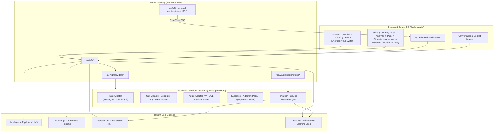

# CloudPilot AI
### Autonomous Multi-Cloud Governance, Optimization, and Operations Operating System

[](https://www.python.org/)
[](https://fastapi.tiangolo.com)
[-brightgreen.svg)](docker/tests)
[]()
[]()
[]()
[]()

---

## Executive Overview

**CloudPilot AI** is an enterprise-grade autonomous cloud governance, cost intelligence, and infrastructure optimization platform. Built on an authoritative safety and autonomy control plane, CloudPilot transitions cloud management from reactive alerting and manual ticketing into safe, explainable, closed-loop autonomous operations.

Unlike traditional dashboards that inundate SREs and FinOps teams with passive charts, CloudPilot actively reasons over live multi-cloud infrastructure, simulates the counterfactual impact of optimization strategies, evaluates risk across 9 safety dimensions, enforces human approval gating, safely applies changes via sandboxes and GitOps pipelines, and continuously verifies post-execution outcomes with automatic rollback.

```
       ┌──────────────────────────────────────────────────────────────┐
       │                 CloudPilot Command Center OS                 │
       │     (15 Workspaces • Guided User Journey • Live Copilot)     │
       └──────────────────────────────┬───────────────────────────────┘
                                      ▼
       ┌──────────────────────────────────────────────────────────────┐
       │              Authoritative Safety Control Plane              │
       │  (Progressive Autonomy L0-L5 • Policy-as-Code • Kill Switch) │
       └──────────────────────────────┬───────────────────────────────┘
                                      ▼
       ┌──────────────────────────────────────────────────────────────┐
       │                 Unified Intelligence Pipeline                │
       │           (M1 Discovery ──► M2 Cost ──► M4 Risk              │
       │            ──► M5 Strategy ──► M6 Digital Twin               │
       │            ──► M8 Learning ──► M9 Decision Engine)           │
       └──────────────────────────────┬───────────────────────────────┘
                                      ▼
       ┌──────────────────────────────────────────────────────────────┐
       │              Production Multi-Cloud Adapters                 │
       │      AWS (Read-Only) • GCP • Azure • Kubernetes • GitOps     │
       └──────────────────────────────────────────────────────────────┘
```

---

## Platform Stack: 8 Integrated Phases

CloudPilot is architected as 8 modular, production-hardened subsystems:

### 1. [Production Platform Foundation](docker/core/)
- Configuration management with strict environment separation (`development`, `staging`, `production`).
- PostgreSQL integration with connection pooling, Alembic database migrations, and health checks.
- Redis integration for distributed locking, pub/sub streaming, and task queuing.
- Structured JSON logging, correlation request tracing, centralized error handling, and Prometheus observability metrics.

### 2. [Digital Enterprise Simulator](docker/simulator/)
- Deterministic simulation of enterprise topologies across **7 industry scenarios**:
  - **SaaS**, **Banking**, **E-commerce**, **AI Research**, **Startup**, **Healthcare**, **Gaming**.
- Generates internally consistent cloud accounts, regions, VPCs, subnets, compute, Kubernetes clusters, databases, storage, IAM roles, dependency graphs, real-time telemetry, and historical optimization opportunities.
- Scale-tested for 100+, 500+, and 1,000+ connected resources.

### 3. [Unified Intelligence Pipeline](docker/pipeline/)
- Closed-loop reasoning pipeline passing structured artifacts across specialized modules:
  - **M1 Infrastructure Discovery**: Multi-cloud topology mapping and dependency graphing.
  - **M2 Cost Intelligence**: Spend baselines, idle waste detection, and multi-horizon cost forecasts.
  - **M3 Application Intelligence**: Service criticality, SLO budgets, and traffic patterns.
  - **M4 Risk Intelligence**: Blast radius calculations, single points of failure (SPOFs), and failure path analysis.
  - **M5 Strategy Agent**: Multi-objective optimization roadmaps balancing cost, availability, and latency.
  - **M6 Digital Twin**: Counterfactual simulation modeling pre- vs. post-action performance.
  - **M7 Explainability**: Causal reasoning graphs and natural-language justifications.
  - **M8 Learning**: Continuous organizational Cloud DNA updating and experience replay.
  - **M9 Decision Engine**: Multi-agent consensus deliberation and weighted voting council.

### 4. [TrueForge Autonomous Agent Runtime](docker/trueforge/)
- Production harness for autonomous infrastructure agents.
- Isolated sandbox execution environment protecting production systems.
- Tool registry exposing safe operations (discovery, analysis, code execution).
- Streaming event telemetry delivering step-by-step reasoning.

### 5. [Safety & Autonomy Control Plane](docker/governance/)
- **Progressive Autonomy Levels**:
  - **L0 — Observe**: Read-only discovery and metric collection.
  - **L1 — Recommend**: Generates candidate optimization plans without execution.
  - **L2 — Simulate**: Counterfactual digital twin validation.
  - **L3 — Execute with Human Approval**: Changes require explicit authorized sign-off.
  - **L4 — Limited Autonomous Execution**: Low-risk changes execute automatically within budget limits.
  - **L5 — Full Autonomous Execution**: High-confidence operations execute autonomously with automated rollbacks.
- **9-Dimension Action Evaluator**: Evaluates Risk, Confidence, Criticality, Policy, Blast Radius, Reversibility, Simulation, Historical Success, and Required Approval.
- **Authoritative Emergency Stop (Kill Switch)**: Instantly halts all mutating executions platform-wide or on scoped environments.
- **Mutual Exclusion Action Locks**: Distributed locks with TTL prevent concurrent modification conflicts on the same cloud resource.

### 6. [Outcome Verification & Learning Loop](docker/verification/)
- **Ex-Ante vs. Ex-Post Verification**: Compares pre-execution expected metrics against empirical post-execution telemetry across **5 dimensions**: Cost, Performance, Availability, Risk, and Savings.
- **Deterministic Rollback Engine**: Automatic and idempotent rollbacks triggered upon safety threshold breaches.
- **3-Way Savings Attribution**: Distinguishes **Predicted Savings** vs. **Verified Savings** vs. **Annualized Run-Rate Savings**.
- **Organizational Cloud DNA**: Continuously tracks deployment style, risk tolerance, rollback frequencies, and autonomy progression.

### 7. [CloudPilot Command Center OS](docker/static/)
- Calm, professional, enterprise-grade Single-Page Application OS.
- **Primary User Journey Stepper**:
  $$\text{Goal} \longrightarrow \text{Analyze} \longrightarrow \text{Plan} \longrightarrow \text{Simulate} \longrightarrow \text{Approval} \longrightarrow \text{Execute} \longrightarrow \text{Monitor} \longrightarrow \text{Verify}$$
- **15 Dedicated Workspaces**: Overview Dashboard, Agent Timeline, Agent Workspaces, Infrastructure Explorer, Cost Intelligence, Risk Explorer, Strategy Workspace, Digital Twin, Decision Council, Approval Center, Execution Console, Rollback View, Learning Timeline, Savings Attribution, and CloudPilot Copilot.
- **Server-Sent Events (SSE)**: Real-time event streaming at `/api/v1/command-center/stream`.
- **Zero Mock Data Guarantee**: Every UI element binds to live backend API state.

### 8. [Production Multi-Cloud Integration & Hardening](docker/providers/)
- Native multi-cloud adapters: **AWS**, **Google Cloud (GCP)**, **Microsoft Azure**, and **Kubernetes**.
- **AWS Default Read-Only Mode**: AWS adapter initializes in `READ_ONLY` mode. Any mutating call raises `ReadOnlyViolationError`.
- **Strict Capability Discovery**: Providers expose only supported capabilities; agents cannot execute unsupported operations (`UnsupportedCapabilityError`).
- **Resilience Engine**: Token bucket rate limiting, three-state circuit breakers (`CLOSED`/`OPEN`/`HALF_OPEN`), exponential backoff retries with full jitter, and correlation request tracing.
- **Secure Credential Vault**: `SecretString` masking, short-lived temporary credentials (AWS STS, GCP OAuth2, Azure MSI, K8s ServiceAccount), least-privilege policy validator, and zero-downtime rotation.
- **Terraform / GitOps 6-Stage Lifecycle**: Plan $\rightarrow$ Review $\rightarrow$ Approval $\rightarrow$ Apply $\rightarrow$ Verify $\rightarrow$ Rollback.

---

## Architecture Diagram



---

## 202/202 Automated Tests Passing (100% Success)

All 202 platform integration tests across all 8 phases pass with zero failures and zero warnings:

```bash
python -m pytest docker/tests -v
```

| Phase | Test Module | Tests | Status |
| :--- | :--- | :--- | :--- |
| **Phase 1** | `test_platform_foundation.py` | 29 | **PASSED (100%)** |
| **Phase 2** | `test_simulator.py` | 28 | **PASSED (100%)** |
| **Phase 3** | `test_pipeline.py` | 21 | **PASSED (100%)** |
| **Phase 4** | `test_trueforge_runtime.py` | 22 | **PASSED (100%)** |
| **Phase 5** | `test_safety_control_plane.py` | 26 | **PASSED (100%)** |
| **Phase 6** | `test_outcome_and_learning_loop.py` | 25 | **PASSED (100%)** |
| **Phase 7** | `test_command_center.py` | 17 | **PASSED (100%)** |
| **Phase 8** | `test_production_providers.py` | 24 | **PASSED (100%)** |
| **Phase 8** | `test_security_and_chaos.py` | 10 | **PASSED (100%)** |
| **TOTAL** | **Full Platform Suite** | **202** | **100% PASSED** |

---

## Quickstart & Installation

### Prerequisites
- Python 3.11+ (Python 3.14 fully supported)
- Git
- Docker & Docker Compose (optional, for containerized deployment)

### 1. Clone & Setup Virtual Environment
```bash
git clone https://github.com/shankarsai000/CloudPilot.git
cd CloudPilot

# Create and activate virtual environment
python -m venv .venv
# On Linux/macOS:
source .venv/bin/activate
# On Windows PowerShell:
.\.venv\Scripts\Activate.ps1

# Install production dependencies
pip install -r docker/requirements.txt
```

### 2. Start CloudPilot Control Plane
```bash
python -m uvicorn main:app --app-dir docker --host 127.0.0.1 --port 8000 --reload
```

### 3. Access the Live Platform
- **Command Center OS**: Open **`http://127.0.0.1:8000/dashboard/`** in your browser.
- **Interactive API Documentation (Swagger)**: Open **`http://127.0.0.1:8000/docs`**.
- **Alternative API Documentation (ReDoc)**: Open **`http://127.0.0.1:8000/redoc`**.

### 4. Run Automated Test Suite
```bash
python -m pytest docker/tests -q
```

---

## Multi-Cloud Provider Configuration

CloudPilot supports secure configuration across all four primary providers:

```bash
# Provider Capability Discovery
curl -X GET http://127.0.0.1:8000/api/v1/providers

# Query specific capabilities (e.g. Google Cloud)
curl -X GET http://127.0.0.1:8000/api/v1/providers/gcp/capabilities

# Check AWS Adapter Status (Confirms Read-Only Safety Mode)
curl -X GET http://127.0.0.1:8000/api/v1/providers/aws/capabilities

# Check Resilience & Circuit Breaker Metrics
curl -X GET http://127.0.0.1:8000/api/v1/providers/resilience/metrics
```

### Triggering the GitOps / Terraform Lifecycle
```bash
# 1. Plan
curl -X POST http://127.0.0.1:8000/api/v1/providers/gitops/pipeline \
  -H "Content-Type: application/json" \
  -d '{
    "stage": "plan",
    "workspace": "prod-k8s",
    "provider": "kubernetes",
    "target_resource": "k8s://production/namespaces/default/deployments/frontend-web",
    "action": "SCALE_DEPLOYMENT",
    "estimated_cost_delta": -40.0
  }'

# 2. Review -> 3. Approval -> 4. Apply -> 5. Verify -> 6. Rollback
```

---

## Production Documentation & Operations Guides

Detailed operational documentation is available in [`docker/docs/`](docker/docs/):
- **[Production Operations Guide](docker/docs/PRODUCTION_OPERATIONS_GUIDE.md)**:
  - Deployment architecture (Kubernetes, Helm, Docker multi-stage build)
  - Secrets management (Vault, STS, OAuth2, credential rotation runbook)
  - Monitoring & Prometheus observability
  - Incident response & Emergency Stop protocols
  - Deterministic rollback runbooks & idempotency guarantees
  - Backups, WAL archiving & PITR
  - Disaster recovery (RPO < 1m, RTO < 5m)
  - Scaling & Horizontal Pod Autoscaler (HPA)
- **[Production-Readiness Verification Report](docker/docs/PRODUCTION_READINESS_REPORT.md)**:
  - Formal sign-off and audit matrix certifying all 202 passing tests, provider capabilities, security controls, and production readiness.

---

## Repository Structure

```
CloudPilot/
├── .github/                       # GitHub Actions workflows & CI configs
├── alembic.ini                    # Database migration configuration
├── docker-compose.yml             # Local multi-container development orchestration
├── pyproject.toml                 # Build system & tooling configuration
├── pytest.ini                     # Pytest runner settings
├── README.md                      # Production repository documentation
└── docker/                        # Core platform codebase
    ├── main.py                    # Application entry point & FastAPI factory
    ├── requirements.txt           # Python dependencies
    ├── core/                      # Phase 1: Platform foundation (config, db, logging, events)
    ├── simulator/                 # Phase 2: Digital Enterprise Simulator (7 scenarios)
    ├── pipeline/                  # Phase 3: Unified Intelligence Pipeline (M1-M9)
    ├── trueforge/                 # Phase 4: TrueForge Autonomous Agent Runtime
    ├── governance/                # Phase 5: Safety & Autonomy Control Plane (L0-L5)
    ├── verification/              # Phase 6: Outcome Verification & Learning Loop
    ├── static/                    # Phase 7: Command Center OS UI (HTML5, Vanilla CSS, JS)
    ├── providers/                 # Phase 8: Multi-Cloud Adapters & GitOps Lifecycle
    ├── docs/                      # Operations guide & production readiness report
    └── tests/                     # 202 platform integration tests
```

---

## Security & Responsible Autonomy

CloudPilot operates under a strict principle of **defensive and explainable autonomy**:
1. **Human Oversight**: High-risk, irreversible, or policy-violating operations are authoritatively gated behind human approval.
2. **Authoritative Emergency Stop**: Operators can trigger the global or scoped kill switch at any time to instantly freeze autonomous mutating actions.
3. **Audit Trail**: Every action, policy evaluation, approval decision, and outcome verification is cryptographically linked with SHA-256 hashes.
4. **AWS Read-Only Safe Start**: AWS integration starts strictly read-only to prevent accidental disruption in production accounts.

---

## License

This project is licensed under the **Apache License 2.0**. See the [LICENSE](LICENSE) file for details.
