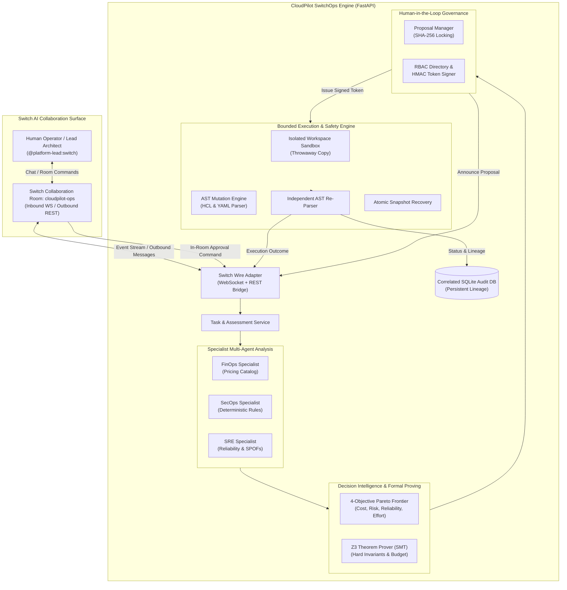

# CloudPilot SwitchOps
### Autonomous Cloud Operations Control Room for Switch AI

[](https://github.com/shankarsai000/CloudPilot-SwitchOps)
[](https://wemakedevs.org/hackathons/switch)
[-brightgreen.svg)](tests/)
[](docs/submission-architecture.md)
[](docs/submission-architecture.md)
[](https://www.python.org/)
[](https://fastapi.tiangolo.com)
[](LICENSE)

> Built for the **Flip the Switch Hackathon — Track 01: Best Business Workflow**  
> Hackathon details: [wemakedevs.org/hackathons/switch](https://www.wemakedevs.org/hackathons/switch)  
> Switch Documentation: [docs.switchagents.ai](https://docs.switchagents.ai/)  
> Repository: [github.com/shankarsai000/CloudPilot-SwitchOps](https://github.com/shankarsai000/CloudPilot-SwitchOps)

---

## 1. Executive Summary & Value Proposition

Modern cloud operations are broken across siloed tools: FinOps discovers cost waste in static spreadsheets, SecOps raises thousands of noisy vulnerability alerts, and SREs fear black-box autonomous agents that modify infrastructure without human oversight.

**CloudPilot SwitchOps** transforms cloud operations into an evidence-backed, human-in-the-loop autonomous control room orchestrated through **Switch AI**.

### Core Operational Cycle:
```
OBSERVE → ANALYZE → OPTIMIZE → PROPOSE → APPROVE → EXECUTE → VERIFY → RECOVER → AUDIT
```

1. **Observe**: Deterministic AST parsing of Terraform and Docker Compose infrastructure.
2. **Analyze**: Specialist multi-agent synthesis across FinOps, SecOps, and SRE dimensions.
3. **Optimize**: Multi-objective Pareto optimization (Cost vs. Risk vs. Reliability vs. Effort).
4. **Formally Prove**: Z3 SMT constraint solving verifying non-negotiable security invariants and budget limits.
5. **Propose**: Cryptographic SHA-256 locked change proposals published to Switch team rooms.
6. **Approve**: Strict role-based human approval issuing single-use HMAC-SHA256 authorization tokens.
7. **Execute**: Bounded mutations executed **strictly within isolated workspace sandboxes**.
8. **Verify**: Independent syntactic AST re-parsing and state comparison before change acceptance.
9. **Recover**: Instant atomic rollback restoration if verification or policy checks fail.
10. **Audit**: Correlated end-to-end SQLite audit trail linking Task, Decision, Proposal, Approval, and Execution.

> **NON-NEGOTIABLE SAFETY BOUNDARY:**  
> CloudPilot SwitchOps enforces a zero live cloud mutation policy (`terraform apply`, `pulumi up`, and direct cloud provider write calls are strictly prohibited). Changes are executed only as bounded configuration mutations inside throwaway sandbox workspaces, leaving source samples completely read-only and preserved.

---

## 2. End-to-End Workflow Architecture



---

## 3. The 14 Core Subsystems

| # | Subsystem Name | Implementation & Architectural Role | Verification Status |
| :-: | :--- | :--- | :-: |
| **01** | **Discovery Engine** | AST parsing of Terraform (`python_hcl2`) & Docker Compose configurations | Hardened |
| **02** | **Normalization Graph** | Cross-cloud resource normalization into an interconnected dependency graph | Hardened |
| **03** | **FinOps Pricing Engine** | Deterministic catalog lookup (AWS/GCP/Azure) with offline estimate disclosure | Hardened |
| **04** | **SecOps Rules Engine** | Deterministic security rule engine evaluating exposure, ports, and blast radius | Hardened |
| **05** | **SRE Rules Engine** | Reliability posture evaluation, single-points-of-failure, and backup checks | Hardened |
| **06** | **Specialist Coordinator** | Multi-agent synthesis consolidating FinOps, SecOps, and SRE assessments | Hardened |
| **07** | **Multi-Objective Optimizer** | 4-objective Pareto frontier calculation (Cost, Risk, Reliability, Effort) | Hardened |
| **08** | **Formal Constraint Solver** | Z3 Theorem Prover (SMT) proving hard invariants and composite budget bounds | Hardened |
| **09** | **Decision Orchestrator** | Candidate generation, combination evaluation, and transparent decision reporting | Hardened |
| **10** | **Approval Center** | 14-point review checklist, SHA-256 proposal locking, and RBAC token signing | Hardened |
| **11** | **Bounded Execution Engine** | Isolated workspace sandboxes, AST mutations, and live cloud write prevention | Hardened |
| **12** | **Verification & Recovery** | Independent AST syntax re-parsing, hash comparison, and atomic rollback | Hardened |
| **13** | **Switch Wire Adapter** | WebSocket streaming + REST outbound bridge with truthful telemetry fallback | Hardened |
| **14** | **Operator Control Room** | Unified dashboard mounted at `/dashboard`, direct REST API binding across all areas | Remediated & Hardened |

---

## 4. Human-in-the-Loop Governance: 14-Point Review

CloudPilot never executes an unapproved change or a change different from the exact diff that an authorized human reviewed. Every proposal undergoes the **14-Point Governance Review**:

1. **Exact AST Target**: Verified against the discovered inventory model.
2. **Pre-Mutation SHA-256 Locked**: Recorded and verified prior to any modification.
3. **Zero Live Cloud Mutations**: Verified boundary preventing cloud provider write calls.
4. **Sandbox Isolation**: Executed strictly in temporary copies (`tempfile` directory).
5. **Multi-Objective Pareto Rank**: Mathematically optimal trade-off score.
6. **Formal Z3 SMT SAT Status**: Constraint satisfiability proven by Z3 solver.
7. **Hard Invariant 1**: Zero public database exposure allowed.
8. **Hard Invariant 2**: Persistent storage volumes strictly retained.
9. **Hard Invariant 3**: Zero unprivileged container security escalation.
10. **Budget Ceiling**: Aggregate post-change spend strictly within configured ceiling.
11. **Server-Side RBAC**: Authorization checked against server directory (`PLATFORM_LEAD`).
12. **Cryptographic HMAC Token**: Single-use token bound to exact `(proposal_id, sha256, approver_id)`.
13. **Independent Syntax Re-Parsing**: Validated by parser before change acceptance.
14. **Correlated Audit Record**: Persisted in SQLite with correlation IDs across all phases.

---

## 5. Formal Verification with Z3 SMT Solver

Unlike heuristics or simple rule engines, CloudPilot SwitchOps uses the **Z3 Theorem Prover** to formally prove that candidate infrastructure changes satisfy operational and security invariants:

$$\text{Satisfiable}(\text{Candidates}) \iff \bigwedge_{i} \text{Invariant}_i \land \sum \text{Cost}_{\text{after}} \le \text{Budget}_{\text{max}}$$

The engine distinguishes:
- `Z3_CONSTRAINTS_SAT`: Constraints and invariants are formally satisfiable.
- `Z3_CONSTRAINTS_UNSAT`: A hard invariant or budget constraint is violated; candidate is disqualified.
- `Z3_UNKNOWN`: Solver timed out or exceeded complexity bounds; treated fail-closed.
- `Z3_UNAVAILABLE`: Solver dependency missing; fails closed to prevent unverified changes.

---

## 6. Switch Collaboration Wire Protocol

CloudPilot integrates natively with the Switch collaboration platform using a dual-mode wire protocol:

- **Inbound Event Stream (WebSocket):**  
  `GET {switch_bridge_ws_url}/agents/{agent_id}/connection/ws`  
  Streams in-room messages, operator review commands, and approval instructions in real time.
- **Outbound Message Channel (HTTP REST):**  
  `POST {switch_bridge_url}/rooms/{room_id}/messages`  
  Publishes formatted proposal reviews, specialist summaries, and verified execution outcomes.
- **Truthful Fallback Engine:**  
  When external Switch bridge infrastructure is absent, CloudPilot operates cleanly in `EMULATED_MODE` without faking network confirmations, truthfully reporting:
  `SUBMISSION_READY_WITH_DOCUMENTED_EXTERNAL_LIMITATION`.

---

## 7. Unified Operator Control Room Dashboard

Served directly by the main FastAPI application at `/dashboard`, the dashboard connects directly to live REST APIs without non-functional mock buttons:

```
http://localhost:8000/dashboard
```

- **Area A: Infrastructure Overview (`/api/v1/tasks`):** Discovered resources, configuration files, and normalized inventory.
- **Area B: Specialist Analysis (`/api/v1/assessments/{task_id}`):** FinOps spend breakdown, SecOps exposure findings, and SRE reliability status.
- **Area C: Decision Intelligence (`/api/v1/decisions`):** 4-objective Pareto frontier table, Z3 solver status badge, and recommended action.
- **Area D: Approval Center (`/api/v1/proposals`, `/api/v1/approvals`):** Proposal ID, SHA-256 hash, diff preview, 14-point review checklist, and Approve/Reject buttons.
- **Area E: Sandbox Execution (`/api/v1/executions`):** Isolated workspace path, before/after SHA-256 hashes, syntax re-parsing status, and live execution console.
- **Area F: Switch Collaboration (`/health/switch`):** Truthful connection mode (`EMULATED` or `LIVE`), room telemetry, and in-room event feed.
- **Area G: Correlated Audit Trail:** Traceable timeline linking Task ID -> Assessment ID -> Decision ID -> Proposal ID -> Approval Token -> Execution ID.

---

## 8. Quick Start Guide (< 2 Minutes)

### Prerequisites
- Python 3.11+
- Git

### 1. Clone & Set Up Virtual Environment
```bash
git clone https://github.com/shankarsai000/CloudPilot-SwitchOps.git
cd CloudPilot-SwitchOps

# Windows:
python -m venv .venv
.\.venv\Scripts\Activate.ps1

# Linux / macOS:
# python3 -m venv .venv && source .venv/bin/activate

pip install -r requirements.txt
```

### 2. Run Automated Verification Suite
```bash
pytest tests docker/tests/test_platform_foundation.py -q
# Expected: 243 passed
```

### 3. Launch Standalone Demonstrations
```bash
# Positive 18-step golden path workflow:
python scripts/demo_submission.py

# Negative 5-gate adversarial safety verification:
python scripts/demo_submission_negative.py
```

### 4. Start the Application & Open Dashboard
```bash
python -m app.main
```
Open your browser to:
```
http://localhost:8000/dashboard
```

---

## 9. REST API Reference

| Endpoint | Method | Description |
| :--- | :---: | :--- |
| `/health/ready` | `GET` | Application and persistence readiness probe |
| `/health/switch` | `GET` | Truthful Switch connection telemetry & wire state |
| `/api/v1/tasks` | `POST` | Create infrastructure discovery & assessment task |
| `/api/v1/tasks/{task_id}` | `GET` | Get task lifecycle status and inventory counts |
| `/api/v1/assessments/{task_id}` | `GET` | Retrieve FinOps, SecOps, and SRE multi-agent findings |
| `/api/v1/decisions` | `POST` | Execute multi-objective Pareto optimization and Z3 solving |
| `/api/v1/decisions/{decision_id}` | `GET` | Retrieve decision run report, Pareto frontier, and Z3 status |
| `/api/v1/proposals` | `POST` | Generate SHA-256 locked proposal from decision run |
| `/api/v1/proposals/{proposal_id}` | `GET` | Inspect proposal details, diff, and pre-mutation hash |
| `/api/v1/approvals/{proposal_id}/token` | `POST` | Request signed HMAC-SHA256 approval token for principal |
| `/api/v1/approvals/{proposal_id}/approve`| `POST` | Grant role-based approval using valid token |
| `/api/v1/approvals/{proposal_id}/reject` | `POST` | Reject change proposal and halt workflow |
| `/api/v1/executions/{proposal_id}/execute`| `POST`| Execute approved proposal inside isolated sandbox |
| `/api/v1/executions/{execution_id}` | `GET` | Retrieve execution record, before/after hashes, syntax check |
| `/dashboard` | `GET` | Unified operator control room frontend |

---

## 10. Role-Based Access Control (RBAC) Matrix

CloudPilot enforces server-side identity verification via `ServerSidePrincipalAuthenticator`:

| Registered Principal | Server-Side Assigned Role | Can View Dashboard | Can Request Optimization | Can Authorize Proposal | Can Execute in Sandbox |
| :--- | :--- | :---: | :---: | :---: | :---: |
| `lead-platform` | `PLATFORM_LEAD` | Yes | Yes | **Yes** | **Yes** |
| `sec-lead` | `SECURITY_LEAD` | Yes | Yes | **Yes** | **Yes** |
| `finops-lead` | `FINOPS_LEAD` | Yes | Yes | **Yes** | No |
| `junior-ops` | `OPERATOR` | Yes | Yes | No | No |
| `guest-viewer` | `VIEWER` | Yes | No | No | No |

---

## 11. Truthful Operational Disclosures

1. **Switch Connectivity**: Unless external Switch Agent Bridge credentials are provided via environment variables, the system operates in verified `EMULATED_MODE`. It never fabricates remote server receipts.
2. **FinOps Pricing Estimates**: Pricing calculations are derived from static AWS, GCP, and Azure public catalog tables. They are baseline engineering estimates, not live cloud billing data.
3. **Local SQLite Persistence**: Audit trail records are stored in a local SQLite relational database. They represent rigorous local evidence records.
4. **Readiness Classification**: The release is truthfully classified as:  
   **`SUBMISSION_READY_WITH_DOCUMENTED_EXTERNAL_LIMITATION`**.

---

## 12. Authors, Acknowledgments & License

- **Author:** CloudPilot SwitchOps Core Team
- **Hackathon:** Flip the Switch — Track 01: Best Business Workflow
- **Collaboration Platform:** Switch AI ([switchagents.ai](https://switchagents.ai/))
- **License:** Apache License 2.0 (see [LICENSE](LICENSE))
