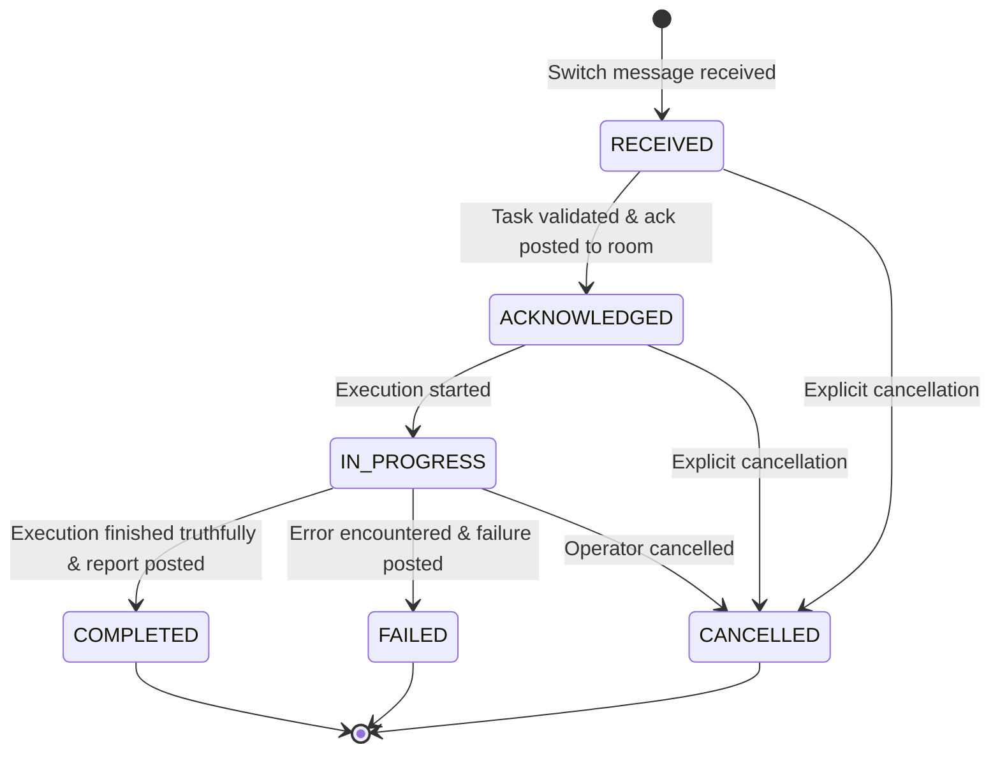

# CloudPilot SwitchOps — Phase 1 System Architecture

## 1. Executive Summary

**CloudPilot SwitchOps** is a Switch-native cloud engineering control room designed for the **Flip the Switch Hackathon (Track 01: Best Business Workflow)**. It allows human operators and autonomous AI agents to collaborate within a shared team-chat room to investigate infrastructure, evaluate trade-offs, approve specific modifications, execute bounded actions, and verify outcomes.

In this architecture, **Switch provides the central collaboration infrastructure**. Switch is not a cosmetic notification sink; without Switch, the collaborative workflow between human and agent does not exist.

---

## 2. Architecture Diagram

```mermaid
flowchart TD
    subgraph HumanCollaboration ["Switch Shared Collaboration Surface"]
        Human["Human Operator / Platform Engineer\n(@operator:switch)"]
        Room["Switch Room: cloudpilot-ops\n(Mattermost / Slack / Discord / Console)"]
        Human <-->|Chat / Commands| Room
    end

    subgraph SwitchCore ["Switch Infrastructure"]
        Bridge["Switch Agent Bridge / Gateway\n(WebSocket + HTTP REST)"]
        Room <-->|Event Buffer & Delivery| Bridge
    end

    subgraph CloudPilotBackend ["CloudPilot SwitchOps Backend (Modular Monolith)"]
        Adapter["Switch Adapter Boundary\napp/integrations/switch\n(SwitchWireClient / EmulatedBridge)"]
        Service["Task Lifecycle & Orchestration\napp/services/TaskService"]
        Domain["Domain Contracts & Transition Policy\napp/domain\n(Task, TaskEvent, Evidence)"]
        Persistence["Persistence Layer\napp/persistence\n(SQLiteTaskRepository)"]
        API["HTTP API & Health Probes\napp/api\n(/health/live, /health/ready, /api/v1/tasks)"]

        Bridge <-->|WebSocket: Events & Pings (<=2s)\nHTTP: Outbound /message| Adapter
        Adapter <-->|Addressed Message Events| Service
        Service -->|Enforces Transitions| Domain
        Service -->|Append-Only Events & Metadata| Persistence
        API -->|Read Probes & State| Persistence
        API -->|Readiness Probe| Adapter
    end

    subgraph Storage ["CloudPilot Data Layer"]
        DB[("SQLite Database\ncloudpilot_tasks.db\n(Tasks, Append-Only Events, Evidence)")]
        Persistence <--> DB
    end
```

---

## 3. Logical Boundaries & Separation of Concerns

The backend is built as a clean, cohesive modular monolith adhering strictly to the architecture principles:

1. **`app/core` (Foundation & Observability)**
   - Configuration management via `Pydantic Settings` with `.env` and environment prefixing (`CLOUDPILOT_*`).
   - Structured JSON logging with context-variable correlation IDs (`X-Correlation-ID`) and task IDs.
   - Automatic regex-based secret redaction (API keys, Bearer tokens, passwords).
   - Structured domain errors (`CloudPilotError`, `InvalidStateTransitionError`, `SwitchIntegrationError`).

2. **`app/domain` (Domain Contracts & State Machine)**
   - Strongly typed Pydantic models for `Task`, `TaskEvent`, and `Evidence`.
   - UTC timestamp normalization on all models.
   - Enforced status lifecycle and transition validation policy.
   - Complete decoupling from transport mechanisms or external SDKs.

3. **`app/persistence` (Persistence Abstraction)**
   - `TaskRepositoryInterface` abstract contract.
   - Thread-safe `SQLiteTaskRepository` ensuring foreign keys, indexing, and transactional integrity.
   - In-memory repository (`InMemoryTaskRepository`) for lightning-fast, zero-IO unit testing.
   - Append-only event history: audit events can never be mutated or silently overwritten.

4. **`app/integrations/switch` (Switch Wire Adapter)**
   - Decoupled `SwitchAdapterInterface`.
   - `SwitchWireClient`: Full implementation of the documented Switch Agent Protocol:
     - Public probe `GET /health`
     - Out-of-band registration `POST /agents`
     - Addressing update `POST /agents/{agent_id}/ops/update_agent_detail`
     - Outbound room messaging `POST /agents/{agent_id}/message`
     - Persistent WebSocket streaming `GET /agents/{agent_id}/connection/ws` with mandatory 2-second heartbeat responses (`{"type": "pong", "cursor": cursor}`).
   - `EmulatedSwitchBridge`: Compliant in-process mock for deterministic CI/CD and offline verification.

5. **`app/services` (Task Lifecycle Orchestration)**
   - `TaskService`: Bridges incoming Switch messages to domain task lifecycles, persists append-only events, and dispatches truthful acknowledgments and reports back to the Switch room.

6. **`app/api` (REST API & Diagnostics)**
   - Health probes (`GET /health/live`, `GET /health/ready`).
   - Read-only task, event history, and evidence query endpoints (`/api/v1/tasks/...`).
   - Diagnostic message simulation endpoint (`POST /api/v1/switch/simulate-message`).

---

## 4. Task Lifecycle State Machine



### Transition Policy Table

| Current Status | Allowed Target Statuses | Notes |
|:---|:---|:---|
| `RECEIVED` | `ACKNOWLEDGED`, `CANCELLED` | Task ingested from room. |
| `ACKNOWLEDGED` | `IN_PROGRESS`, `CANCELLED` | Acknowledgment message dispatched to room. |
| `IN_PROGRESS` | `COMPLETED`, `FAILED`, `CANCELLED` | Read-only baseline evaluation executed. |
| `COMPLETED` | *(None)* | Terminal state. Report posted to room. |
| `FAILED` | *(None)* | Terminal state. Error logged and reported. |
| `CANCELLED` | *(None)* | Terminal state. Operation aborted. |

Any transition not explicitly defined in the policy raises an `InvalidStateTransitionError` (HTTP 409 Conflict).

---

## 5. Switch Centrality Proof

**Question:** *"If Switch is unavailable, can a human still complete the same collaborative workflow through a separate application interface?"*

**Answer: NO.**
- The human-agent collaborative workflow (receiving instructions, reviewing staging infrastructure, requesting clarifications, delivering acknowledgments, and reporting findings) requires Switch as the collaboration medium.
- While developer diagnostic endpoints exist for automated CI testing and readiness monitoring, there is no separate standalone user chat interface bypassing Switch.
- Switch provides the shared room context, participant identity, and message history.
