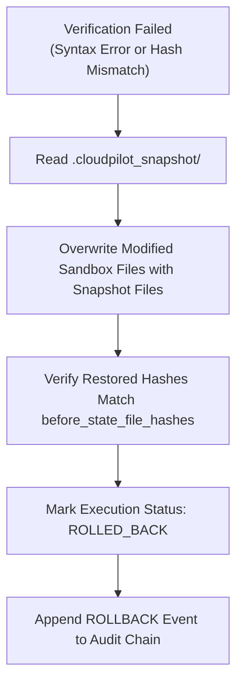

# CloudPilot SwitchOps — Bounded Sandbox Execution

---

## 1. Non-Negotiable Safety Boundaries

CloudPilot SwitchOps Phase 4 introduces **bounded repository-level infrastructure file execution**.

### Prohibited Operations
To prevent accidental outages or unauthorized cloud infrastructure mutation, the execution engine enforces strict, unbreakable isolation boundaries:
- **NO `terraform apply` or `terraform destroy`**
- **NO `pulumi up` or `pulumi destroy`**
- **NO live Kubernetes API write operations** (`kubectl apply`, `helm install`)
- **NO cloud provider write APIs** (AWS SDK, Azure SDK, Google Cloud SDK mutation calls)
- **NO arbitrary shell execution** or unsanitized subprocesses
- **NO modifications to source repositories or sample folders** (`samples/staging` remains 100% read-only)

All modifications occur exclusively inside a transient, isolated directory sandbox provisioned per execution:
```
.cloudpilot/workspaces/{execution_id}/
```

---

## 2. Sandbox Isolation & Workspace Containment

When an approved proposal is dispatched for execution:
1. **Creation**: The `WorkspaceManager` generates an isolated sandbox directory:
   `.cloudpilot/workspaces/{execution_id}/`
2. **Strict Allowlisting**: Only files declared in `proposal.source_file_paths` are copied into the sandbox. All other workspace files are excluded.
3. **Path Traversal Guards**: Any relative path with `..` or leading slashes that attempts to escape the root boundary is blocked immediately with an `ExecutionSecurityError`.
4. **File Size Enforcement**: Any file exceeding 5MB is rejected to protect against memory exhaustion and denial-of-service vulnerabilities.

---

## 3. Pre-Execution Recovery Snapshot

Before applying any modifications:
1. The `RecoveryManager` captures an atomic snapshot of all allowlisted files into:
   ```
   .cloudpilot/workspaces/{execution_id}/.cloudpilot_snapshot/
   ```
2. The snapshot records the exact SHA-256 hash of each file prior to modification.
3. If any subsequent step fails, this snapshot serves as the trusted restoration source for automated rollback.

---

## 4. Structured Declarative Mutation

The `ChangeApplier` applies changes using structured, syntax-aware primitives rather than loose text manipulation:
- **Permitted Operations**: `MODIFY`, `UPDATE_ATTRIBUTE`, `REPLACE_VALUE`, `ADD_BLOCK`, `ADD`, `REMOVE`.
- **Terraform HCL Handling**: Matches attribute definitions (`key = value`), replaces values preserving formatting, or appends cleanly formatted declarative blocks.
- **Docker Compose YAML Handling**: Identifies YAML mapping keys (`key: value`), substitutes values, or appends indented attributes.
- **Deterministic Formatting**: Enforces newline byte conventions (`\n`) to ensure hash parity across Windows, macOS, and Linux platforms.

---

## 5. Post-Execution Verification Pipeline

Once all changes are written to the sandbox:
1. **Independent Syntax Parsing**:
   - `TerraformParser` re-parses all `.tf` files in the isolated workspace.
   - `ComposeParser` re-parses all `.yml`/`.yaml` files in the isolated workspace.
   - Any syntax error, broken bracket, or invalid YAML structure immediately fails the verification.
2. **After-State SHA-256 Hash Verification**:
   - The SHA-256 hash of each modified sandbox file is computed.
   - The computed hash is compared directly against the `expected_after_state_file_hashes` pre-calculated in the proposal.
   - If even a single byte differs from the pre-computed hash, verification fails immediately.

---

## 6. Automated Recovery & Rollback

If post-execution verification fails (due to syntax invalidity or hash mismatch):


1. The `RecoveryManager` copies files from `.cloudpilot_snapshot/` back into the workspace.
2. The restored files are re-hashed to verify they match `before_state_file_hashes`.
3. The execution status is transitioned to `ROLLED_BACK`.
4. An error event is logged in the cryptographic audit trail, and an alert is dispatched to the Switch room.

---

## 7. Cryptographic Hash-Chained Audit Trail

Every state transition and file modification is recorded in an immutable, append-only cryptographic event log.

### Chaining Formula
For each event $i$:
$$\text{event\_hash}_i = \text{SHA256}(\text{event\_hash}_{i-1} + \text{execution\_id} + \text{event\_type} + \text{payload\_json} + \text{timestamp})$$

For the genesis event ($i=0$):
$$\text{event\_hash}_0 = \text{SHA256}(\text{execution\_id} + \text{"GENESIS"} + \dots)$$

### Independent Audit Verification
The system provides a verification endpoint (`GET /api/v1/executions/{execution_id}/audit`) and an audit utility (`verify_audit_trail`) that iterates through all stored events for an execution, recalculates each SHA-256 digest against its parent link, and verifies that no events have been modified, deleted, or injected.

---

## 8. Static Non-Mutation Disclaimer

Every execution record, API response, and Switch room execution announcement includes the mandatory non-mutation safety disclaimer:

> **SAFETY NOTICE: CloudPilot Bounded Execution operates exclusively at the repository and configuration file level within isolated workspace sandboxes. It does NOT invoke 'terraform apply', 'pulumi up', or execute live cloud mutating APIs. Changes must be reviewed, committed to version control, and applied through your organization's approved CI/CD pipeline.**
