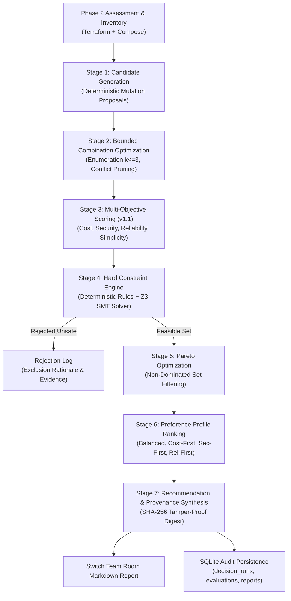

# CloudPilot SwitchOps — Phase 3.1 Decision Intelligence Engine (Hardened)

## 1. Executive Summary

CloudPilot SwitchOps Phase 3 transforms CloudPilot from a diagnostic infrastructure assessment tool into an **evidence-driven autonomous engineering decision engine**. Phase 3.1 hardens the mathematical foundation, introduces formal Z3 SMT constraint verification, implements bounded combination optimization ($k \le 3$), and provides tamper-proof SHA-256 evidence provenance.

Operating strictly under read-only boundaries (zero uncontrolled mutations, zero live cloud writes, zero float drift), Phase 3 answers ten fundamental engineering questions for every environment:

1. **What changes are possible?** Concrete candidate proposals generated deterministically from Phase 2 assessment findings and declarative infrastructure declarations.
2. **Which changes reduce cost?** Explicit financial models calculating monthly delta spend in USD using Python `Decimal` arithmetic.
3. **Which changes improve security?** Rigorous checks removing public database bindings, stripping privileged containers, and enforcing encryption at rest.
4. **Which changes improve reliability?** SLA protections preserving persistent volumes, mandating multi-AZ failover, and validating container healthchecks.
5. **Which changes violate mandatory constraints?** Formal rejection by deterministic rules and the Microsoft Z3 SMT theorem prover.
6. **Which combinations of changes are feasible?** Candidate interaction detection identifying mutual exclusions, redundancies, and dependencies.
7. **What trade-offs exist between options?** 4-dimensional normalized objective vectors spanning Cost, Security, Reliability, and Simplicity.
8. **Which options are Pareto-optimal?** True multi-objective dominance filtering identifying the non-dominated frontier.
9. **What should CloudPilot recommend, and why?** An authoritative recommendation selected by operator preference profile (`BALANCED`, `COST_FIRST`, `SECURITY_FIRST`, `RELIABILITY_FIRST`) with complete executive rationale.
10. **What evidence supports the recommendation?** Full SHA-256 evidence provenance tracing every proposed change back to AST nodes in Terraform (`*.tf`) and Compose (`compose.yaml`).

---

## 2. Core Architecture Pipeline

The decision engine executes as an automated, truth-preserving seven-stage pipeline:

---

## 3. Seven Operational Stages

### Stage 1: Candidate Generation
- Derives typed candidate modifications directly from Phase 2 findings (`FIN-001`, `FIN-002`, `FIN-003`, `FIN-005`, `SEC-001`..`005`, `REL-001`..`003`).
- Constructs normalized `ProposedChange` contracts specifying exact AST attribute paths, current values, and proposed modifications.
- Synthesizes adversarial candidates (e.g. dropping stateful volumes, exposing database ports to 0.0.0.0/0) to prove hard constraint enforcement.

### Stage 2: Bounded Combination Optimization ($k \le 3$)
- Systematically generates candidate combinations of size $k \in \{2, 3\}$.
- Detects mutually conflicting proposals mutating the same resource attributes contradictorily and prunes them upfront.
- Validates dependency closure (e.g., dependent candidates only included if prerequisite parent is present).
- Calculates combined financial impact with Python `Decimal` arithmetic.
- Explicitly tags output with `optimization_scope = "BOUNDED_COMBINATION (k=3)"`.

### Stage 3: Multi-Objective Objective Scoring (Model v1.1)
- Evaluates four normalized dimensions on a `[0.0, 100.0]` scale:
  - **Cost Score**: Scaled relative to monthly baseline. Bounded to $[0.0, 100.0]$. Handles negative savings (cost increases) and zero-baseline environments without division by zero.
  - **Security Score**: Mapped from standard impact levels (`HIGH_POSITIVE` $\rightarrow$ 90, `POSITIVE` $\rightarrow$ 75, `NEUTRAL` $\rightarrow$ 50, `NEGATIVE` $\rightarrow$ 20, `HIGH_NEGATIVE` $\rightarrow$ 5).
  - **Reliability Score**: Mapped from resilience and failover contributions.
  - **Simplicity Score**: Operational ease (`LOW` complexity $\rightarrow$ 100, `MEDIUM` $\rightarrow$ 65, `HIGH` $\rightarrow$ 30).
- Applies explicit uncertainty penalties for unverified assumptions and lower model confidence.

### Stage 4: Constraint Validation & Formal Z3 SMT Verification
- Evaluates hard constraints (`CONST-OPS-01`, `CONST-SEC-01`..`05`, `CONST-REL-01`, `CONST-FIN-01`).
- Translates candidate selection, mutual exclusions, dependencies, and budget inequalities into first-order logic for the **Z3 SMT Solver** (`z3-solver 5.3.3.0`).
- Outputs standardized satisfiability statuses:
  - `Z3_CONSTRAINTS_SAT`: Invariants and budget constraints are formally satisfiable (proves satisfiability of encoded constraints, not a mathematical proof of global runtime safety).
  - `Z3_CONSTRAINTS_UNSAT`: Invariants or budget constraints are mutually contradictory.
  - `Z3_UNKNOWN`: Solver timed out or reached search limits.
  - `Z3_UNAVAILABLE`: Native solver unavailable in runtime environment.
  - `RULE_ENGINE_VALIDATED`: Rule-engine evaluated without formal solver.
- **Fundamental Rule**: Preference profiles can NEVER override a hard constraint.

### Stage 5: Pareto Frontier Optimization
- Implements true Pareto dominance: Candidate $A$ dominates $B$ iff:
  $$\forall d \in \{\text{Cost}, \text{Security}, \text{Reliability}, \text{Simplicity}\}: A_d \ge B_d \quad \land \quad \exists d: A_d > B_d$$
- Partitions candidates into:
  1. **Pareto Optimal**: The non-dominated boundary of feasible trade-offs (including atomic and composite plans).
  2. **Dominated**: Feasible candidates surpassed in all dimensions by at least one Pareto optimal candidate.
  3. **Infeasible**: Excluded by hard policy or budget constraints.

### Stage 6: Preference Profile Utility Ranking
- Applies operator-chosen preference profiles to rank candidates exclusively *within* the non-dominated Pareto set:
  - `BALANCED`: Balanced weighting across all dimensions.
  - `COST_FIRST`: Prioritizes immediate OpEx reduction.
  - `SECURITY_FIRST`: Prioritizes posture hardening and risk elimination.
  - `RELIABILITY_FIRST`: Prioritizes high availability, failover, and uptime.

### Stage 7: Recommendation, Evidence Provenance & Switch Room Reporting
- Selects the top-ranked non-dominated candidate as the executive recommendation.
- Computes SHA-256 evidence provenance digest over all decision inputs, findings, and policies.
- Formulates a transparent, CTO-grade decision report explaining recommendation rationale, trade-offs, and rejected options.
- Publishes report to the Switch collaboration room.
