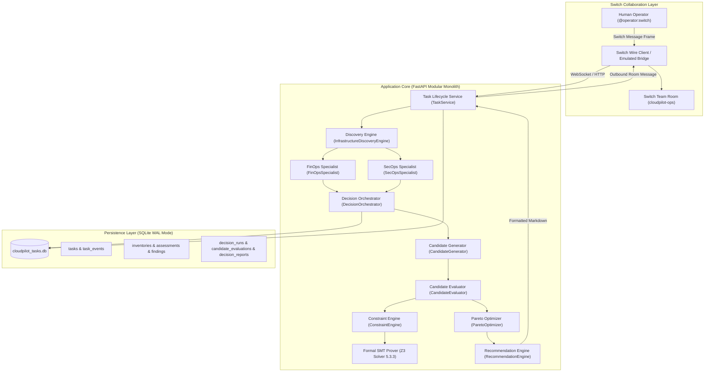

# CloudPilot SwitchOps — Phase 3 Architecture Blueprint

## 1. System Context & Boundaries

CloudPilot SwitchOps Phase 3 introduces **Decision Intelligence, Constraint Validation & Multi-Objective Optimization** on top of the Phase 1 Engineering Foundation and Phase 2 Discovery & Assessment layers.



---

## 2. Domain & Service Directory Structure

```
app/
├── api/
│   ├── assessments.py         # Phase 2 inventory & assessment query routes
│   ├── decisions.py           # Phase 3 decision intelligence & Pareto routes
│   ├── health.py              # Probes (livez, readyz)
│   └── tasks.py               # Task lifecycle routes
├── domain/
│   ├── candidates.py          # Candidate, ProposedChange, CandidateType, ImpactLevel
│   ├── constraints.py         # ConstraintResult, ConstraintType, ConstraintSeverity
│   ├── decisions.py           # DecisionRun, DecisionReport, CandidateEvaluation, ParetoStatus
│   ├── finding.py             # Finding, AssessmentSummary, RuleId
│   ├── inventory.py           # DiscoveredResource, InfrastructureInventory
│   ├── models.py              # Task, TaskEvent, Evidence
│   ├── objectives.py          # ObjectiveScores, PreferenceProfile, PREFERENCE_WEIGHTS
│   └── policies.py            # PolicyConfiguration
├── persistence/
│   └── repository.py          # TaskRepositoryInterface, InMemoryTaskRepository, SQLiteTaskRepository
└── services/
    ├── decision/
    │   ├── candidate_evaluator.py     # Coordination of scoring, constraints, interactions
    │   ├── candidate_generator.py     # Deterministic finding-to-candidate derivation
    │   ├── constraint_engine.py       # Hard constraint validation + Z3 SMT solver
    │   ├── decision_orchestrator.py   # Master workflow orchestrator
    │   ├── explanation_engine.py      # Executive rationale & trade-off analyzer
    │   ├── objective_calculator.py    # 4D scoring & Decimal monetary delta calculator
    │   ├── pareto_optimizer.py        # Genuine non-dominated Pareto frontier calculation
    │   └── recommendation_engine.py   # Report builder & Switch markdown formatter
    ├── discovery/                     # Phase 2 discovery & parsers
    ├── specialists/                   # FinOps & SecOps specialist agents
    └── task_service.py                # Switch message routing & coordination
```

---

## 3. Scope Enforcement

### Strictly In-Scope (Implemented & Verified)
- Deterministic candidate generation from infrastructure ASTs and specialist findings.
- Decimal monetary arithmetic with zero float drift.
- Hard constraint validation enforcing non-negotiable security, reliability, and budget bars.
- Formal Z3 SMT constraint satisfiability verification (`Z3_VERIFIED_SAT` / `Z3_VERIFIED_UNSAT`).
- True multi-objective Pareto dominance calculation ($O(n^2)$ vector comparisons).
- Operator preference profiles ranking candidates within the non-dominated Pareto set.
- Candidate interaction and conflict detection.
- Full SQLite persistence across decision runs, evaluations, interactions, and reports.
- Bi-directional Switch team room communication.
- 100% read-only operation: zero file mutations, zero live cloud writes.

### Strictly Out-of-Scope (Preserved for Phase 4)
- Automated Terraform `apply` or `destroy` execution.
- Automated Docker Compose mutations or live container restarts.
- Autonomous write operations against AWS, Azure, or GCP accounts.
- Human approval workflows, approval tokens, and role-based execution gating.
- Git commit or pull request automation.
