# CloudPilot SwitchOps — Phase 4 Architecture
## Human-in-the-Loop Approval & Bounded Execution

---

## 1. Executive Summary

Phase 4 completes the closed-loop governance cycle of **CloudPilot SwitchOps**:
```
OBSERVE → ANALYZE → OPTIMIZE → PROPOSE → APPROVE → EXECUTE → VERIFY → RECOVER → AUDIT
```

The central architectural axiom is:
> **"CloudPilot must never execute a change different from the exact change that an authorized human approved."**

This phase introduces **bounded, sandboxed repository-level configuration file mutations**. It strictly guarantees zero live cloud mutation (no `terraform apply`, no `pulumi up`, no write calls to AWS/GCP/Azure/Kubernetes APIs, and no modifications to source sample files). All mutations are executed strictly within isolated per-execution sandbox directories under `.cloudpilot/workspaces/{execution_id}` with automated rollback and cryptographically chained audit logging.

---

## 2. The 9-Stage Operational Lifecycle

```mermaid
flowchart TD
    subgraph ObserveStage ["1. OBSERVE"]
        D1["Infrastructure Discovery Engine\n(Terraform & Docker Compose Parsers)"]
    end

    subgraph AnalyzeStage ["2. ANALYZE"]
        A1["FinOps Specialist\n(Cost & Waste Analysis)"]
        A2["SecOps & SRE Specialist\n(Security & Reliability Rules)"]
    end

    subgraph OptimizeStage ["3. OPTIMIZE"]
        O1["Candidate Generator\n(Atomic Remediations)"]
        O2["Combination Optimizer\n(Pareto Frontier & Z3 SMT)"]
    end

    subgraph ProposeStage ["4. PROPOSE"]
        P1["ApprovalService.create_proposal_from_decision\n(Pre-computed SHA-256 hashes, TTL, Proposal Hash)"]
        P2["Switch Room Announcement\n(Auto-notifies @cloudpilot-ops with proposal ID)"]
    end

    subgraph ApproveStage ["5. APPROVE"]
        AP1["HMAC-SHA256 Token Issuance\n(Role Verification: PLATFORM_LEAD, SECURITY_LEAD, FINOPS_LEAD)"]
        AP2["Human Approval via Switch or API\n(@cloudpilot-ops-agent approve proposal prop-xxxx)"]
    end

    subgraph ExecuteStage ["6. EXECUTE"]
        E1["Pre-Execution Policy Check\n(Drift Detection & Constraint Re-check)"]
        E2["Isolated Sandbox Provisioning\n(.cloudpilot/workspaces/exec-xxxx)"]
        E3["Pre-Execution Snapshot Capture\n(.cloudpilot_snapshot)"]
        E4["Structured Change Applier\n(HCL & YAML Declarative Mutations)"]
    end

    subgraph VerifyStage ["7. VERIFY"]
        V1["Independent Syntax Parser\n(TerraformParser & ComposeParser)"]
        V2["After-State Hash Verification\n(Matches Proposal Hashes Exactly)"]
    end

    subgraph RecoverStage ["8. RECOVER"]
        R1{"Verification Passed?"}
        R2["Commit Execution & Retain Evidence"]
        R3["Atomic Rollback from Snapshot\n(Restores Before-State & Verifies Hashes)"]
        R1 -->|Yes| R2
        R1 -->|No| R3
    end

    subgraph AuditStage ["9. AUDIT"]
        AU1["Append-Only Hash-Chained Audit Trail\n(SHA-256 Chained Events & SQLite Persistence)"]
        AU2["Switch Room Final Report\n(Posts applied mutations, diffs, & audit summary)"]
    end

    D1 --> A1 & A2
    A1 & A2 --> O1
    O1 --> O2
    O2 --> P1 --> P2
    P2 --> AP1 --> AP2
    AP2 --> E1 --> E2 --> E3 --> E4
    E4 --> V1 --> V2 --> R1
    R2 --> AU1 --> AU2
    R3 --> AU1 --> AU2
```



---

## 3. Core Subsystems & Components

### 3.1 Proposal Subsystem (`app/domain/proposals.py`, `app/services/approval/approval_service.py`)
- **`Proposal` Model**: Encapsulates decision context, selected candidate, affected resource IDs, allowlisted source files, before-state SHA-256 hashes, pre-simulated expected after-state SHA-256 hashes, and canonical proposal hash.
- **Hash Invariance**: The `proposal_hash` binds the candidate ID, affected resources, attribute mutations, and policy version. Any change in the proposal invalidates this hash.
- **Sequential Mutation Simulation**: Simulates all modifications across targeted files sequentially so expected after-state hashes match execution bit-for-bit.

### 3.2 HMAC-SHA256 Token Manager (`app/services/approval/approval_token.py`)
- **Token Format**: `v1.<proposal_id>.<nonce>.<timestamp>.<hmac_signature>`
- **Security Invariants**:
  - Bound to specific proposal ID and approver identity.
  - Constant-time verification (`hmac.compare_digest`) prevents timing attacks.
  - Strict TTL expiration (default 3600s, max 86400s).
  - Single-use consumption (consumed nonce tracking prevents replay attacks).

### 3.3 RBAC & Approval Validator (`app/services/approval/approval_validator.py`)
- **Permitted Approver Roles**:
  - `PLATFORM_LEAD`
  - `SECURITY_LEAD`
  - `FINOPS_LEAD`
- **Rejection of Unauthorized Roles**: `DEVELOPER`, `OPERATOR`, `VIEWER` are rejected with HTTP 403 Forbidden.
- **Integrity Validation**: Rejects proposals that are already expired, rejected, executed, or have drifted from source files.

### 3.4 Isolated Workspace Containment (`app/services/execution/workspace_manager.py`)
- **Sandboxed Directory**: `.cloudpilot/workspaces/{execution_id}`
- **Allowlist Containment**: Only explicitly declared target files from the proposal are copied into the sandbox.
- **Protection Boundaries**:
  - Rejects absolute paths or path traversals (`../`) attempting to escape the workspace.
  - Enforces a 5MB maximum file size limit.
  - Source directories (e.g. `samples/staging`) are treated as read-only templates and never modified.

### 3.5 Structured Change Applier (`app/services/execution/change_applier.py`)
- Restricts operations to declarative mutation primitives: `MODIFY`, `UPDATE_ATTRIBUTE`, `REPLACE_VALUE`, `ADD_BLOCK`, `ADD`, `REMOVE`.
- Rejects arbitrary string replacements, raw text concatenation, or script execution.
- Employs deterministic newline (`\n`) formatting to ensure cross-platform hash reproducibility across Windows, Linux, and macOS.

### 3.6 Independent Verification Runner (`app/services/execution/validation_runner.py`)
- Re-parses modified files using the Phase 2 `TerraformParser` and `ComposeParser`.
- Asserts that all generated files are syntactically valid HCL / YAML.
- Asserts that the SHA-256 hash of each modified file in the sandbox exactly matches the `expected_after_state_file_hashes` pre-computed in the proposal.
- Attaches the mandatory static non-mutation disclaimer to all execution records.

### 3.7 Recovery & Rollback Engine (`app/services/execution/recovery_manager.py`)
- Captures an isolated pre-execution backup in `.cloudpilot_snapshot`.
- If syntax verification fails or after-state hashes mismatch:
  1. Automatically triggers atomic rollback.
  2. Restores files from `.cloudpilot_snapshot`.
  3. Verifies that restored file hashes match the original `before_state_file_hashes`.
  4. Marks execution as `ROLLED_BACK`.

### 3.8 Cryptographic Hash-Chained Audit Log (`app/services/execution/execution_audit.py`)
- Append-only event stream persisted in SQLite.
- Every event records `event_id`, `execution_id`, `event_type`, `payload`, `timestamp`, `prev_event_hash`, and `event_hash`:
  $$\text{event\_hash} = \text{SHA256}(\text{prev\_hash} + \text{execution\_id} + \text{event\_type} + \text{payload} + \text{timestamp})$$
- Independent audit verification (`verify_audit_trail`) iterates through the chain and guarantees zero tampering.

---

## 4. Verification Evidence Matrix

| Check | Requirement | Implementation | Test Coverage |
| :--- | :--- | :--- | :--- |
| **No Approval No Execution** | Execution fails without valid human approval | `ExecutionPolicy.validate_pre_execution` | `test_execution_without_approval_rejected` |
| **Tamper Protection** | Modified proposal hash rejects execution | `Proposal.compute_proposal_hash` | `test_tampered_proposal_rejected` |
| **RBAC Enforcement** | Non-lead roles cannot issue tokens or approve | `ApprovalValidator.validate_approver` | `test_unauthorized_approver_role_rejected` |
| **Replay Protection** | Tokens cannot be reused | `HMACApprovalTokenManager.consume_token` | `test_token_reuse_rejected` |
| **Workspace Isolation** | Production / sample files are untouched | `WorkspaceManager.create_isolated_workspace` | `test_samples_staging_remains_unmodified` |
| **Path Traversal Guard** | Paths escaping workspace are blocked | `WorkspaceManager._normalize_and_validate` | `test_path_traversal_prevention` |
| **Syntax Verification** | Invalid HCL/YAML triggers automatic rollback | `ValidationRunner.validate_execution` | `test_invalid_syntax_triggers_rollback` |
| **Hash Verification** | Unexpected output hashes trigger rollback | `ValidationRunner._verify_after_state_hashes` | `test_after_state_hash_mismatch_rollback` |
| **Audit Chaining** | Audit trail is cryptographically tamper-evident | `ExecutionAuditLog.record_event` | `test_cryptographic_audit_trail_chaining` |

