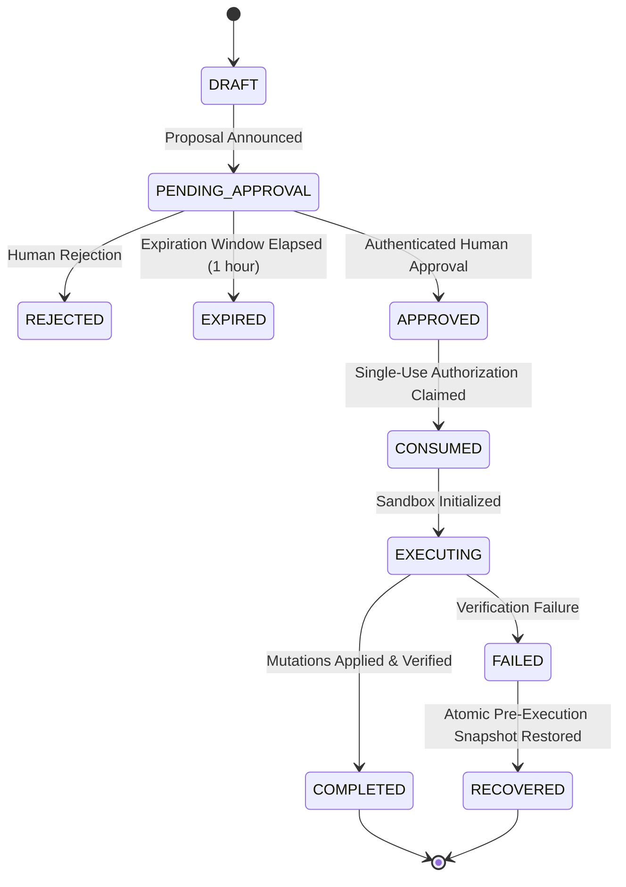

# CloudPilot SwitchOps — Phase 4.2 Human-in-the-Loop Approval Workflow
## 14-Point Proposal Transparency Standard & Dual-Path Authorization

---

## 1. The 14-Point Proposal Transparency Standard

Before any infrastructure mutation can be authorized, CloudPilot SwitchOps publishes a comprehensive proposal announcement to the Switch collaboration room. To satisfy Workstream C1, the proposal formats 14 explicit transparency points:

1. **Analyzed Infrastructure:** Absolute or workspace-relative path and discovered resource identifiers.
2. **Identified Problem:** Root-cause finding summaries, severity tags, and rule IDs (`FIN-001`, `SEC-008`).
3. **Why Recommended:** Multi-objective rationale explaining why the Pareto frontier favored this action under the active profile (`BALANCED`, `COST_FIRST`, `SECURITY_FIRST`, `RELIABILITY_FIRST`).
4. **Proposed Configuration Changes:** Granular file-by-file preview displaying target files, attributes, current values, proposed values, and expected effects.
5. **Estimated Financial Impact:** Estimated monthly baseline cost before and after modification, monthly delta in USD, with an explicit disclosure that figures derive from deterministic offline catalogs.
6. **Security Impact:** Deterministic security delta classification (`POSITIVE`, `NEUTRAL`, `NEGATIVE`).
7. **Reliability Impact:** Deterministic reliability delta classification (`POSITIVE`, `NEUTRAL`, `NEGATIVE`).
8. **Operational Complexity & Rollback Feasibility:** Qualitative risk ranking (`LOW`, `MEDIUM`, `HIGH`) alongside automated snapshot reversion plan.
9. **Hard Constraints & Formal Verification:** Verification status (`Z3_CONSTRAINTS_SAT`, `RULE_ENGINE_VALIDATED`) with active policy version reference.
10. **Evidence & Assumptions:** Underlying assumptions (e.g., 730 hours/month run-time, static HCL/YAML analysis).
11. **Known Uncertainties:** Clear disclosure of runtime factors not observable via static configuration files alone.
12. **State File Cryptographic Digests:** SHA-256 before-state hashes and predicted after-state hashes for all target files.
13. **Canonical Proposal Binding:** Immutable linkage tuple (`task_id`, `decision_id`, `proposal_id`, `candidate_id`, `proposal_hash`).
14. **Execution Scope & Safety Boundary:** Plain-language declaration that mutations run strictly in an air-gapped local sandbox and live cloud mutations (`terraform apply`) are prohibited.

---

## 2. Dual-Path Authorization Model

CloudPilot SwitchOps provides two secure, mutually verifying authorization paths:

### Path A: In-Room Natural Language Command (Switch Native)

Authorized engineering leads can approve or reject proposals directly within the Switch chat room:

```text
@cloudpilot-ops-agent approve proposal prop-5dc90a7f55
@cloudpilot-ops-agent reject proposal prop-5dc90a7f55 reason: deferred to next quarter
```

#### Authentication Enforcement:
- The sender handle (e.g. `@platform-lead:switch`) is validated against an authoritative server-side directory (`SERVER_PRINCIPAL_DIRECTORY`).
- Display names (`sender_name`) and caller-supplied role metadata (`user_role`) are strictly untrusted.
- If the sender is unregistered or possesses insufficient privileges (`OPERATOR`, `VIEWER`), the request is rejected with an in-room denial notice, and the proposal remains unchanged.

### Path B: Authenticated REST API (Automated / CI/CD)

For external orchestration or hardened platform pipelines:

1. **Request Single-Use Token:**
   `POST /api/v1/approvals/{proposal_id}/token`
   - Requires valid `Authorization: Bearer <jwt>` or authenticated server headers.
   - Issues an ephemeral, proposal-bound HMAC token: `tok-<uuid>`.
2. **Submit Formal Approval:**
   `POST /api/v1/approvals/{proposal_id}/approve`
   - Payload binds `token_id`, `proposal_hash`, and approver identity.
   - Enforces cryptographic hash comparison and immediately consumes the token.

---

## 3. Proposal Lifecycle State Machine



---

## 4. Single-Use HMAC Token Integrity

To prevent replay attacks and race conditions:
- Tokens are keyed to the exact canonical proposal SHA-256 digest:
  $$\text{HMAC-SHA256}\left(\text{secret\_key}, \text{proposal\_id} \,\|\, \text{proposal\_hash} \,\|\, \text{approver\_id} \,\|\, \text{nonce}\right)$$
- Tokens are strictly single-use. Once submitted or claimed for execution, the token is permanently invalidated in SQLite storage.
- Submitting an approval for a modified proposal hash fails closed with `409 Conflict`.
