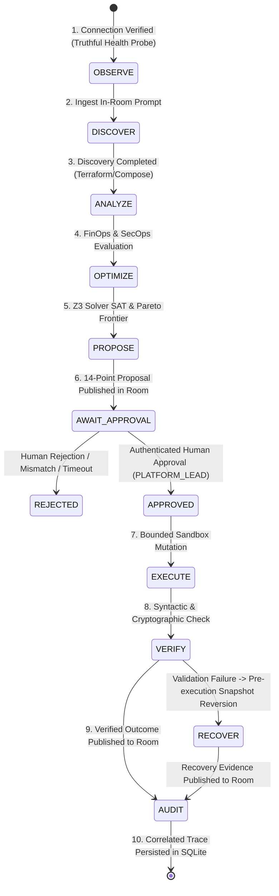

# CloudPilot SwitchOps — Phase 4.2 Architecture Specification
## Verified Switch Integration & End-to-End Human-Approved Execution

**Release Target:** `v4.2.0-live-switch-workflow`  
**Baseline Release:** `v4.1.0-phase4-security-hardened` (`43d4c6e`)  
**Hackathon Target:** Flip the Switch Hackathon — Track 01: Best Business Workflow  

---

## 1. Executive Summary

CloudPilot SwitchOps Phase 4.2 completes the transition of CloudPilot from an air-gapped decision engine into an operational, **Switch-native cloud engineering control room**. Through verified integration with the Switch Agent Bridge wire protocol, engineering leads and autonomous specialist agents collaborate directly in shared team-chat rooms to observe infrastructure, evaluate multi-objective trade-offs, review formal proposals, grant authenticated authorizations, execute bounded file mutations, and verify outcomes with cryptographic integrity.

Central to this phase is the **Axiom of Truthful Integration**: CloudPilot never claims live Switch connectivity when operating against emulated bridges or unreachable endpoints, distinguishes 7 explicit integration states, redacts all cryptographic tokens and secrets from chat rooms, and strictly confines infrastructure modifications to isolated filesystem sandboxes.

---

## 2. High-Level System Architecture

```mermaid
flowchart TD
    subgraph Human Engineering Team ["Human Engineering Team (Switch Room: cloudpilot-ops)"]
        Lead["Platform Lead (@platform-lead:switch)"]
        Operator["Platform Operator (@operator:switch)"]
    end

    subgraph Switch Bridge Boundary ["Switch Agent Bridge Wire Protocol (v1)"]
        WSIn["WebSocket Inbound (Events / Heartbeats)"]
        HTTPOut["HTTP Outbound (Messages / Status)"]
        ConnMgr["SwitchConnectionManager\n- Jittered Backoff\n- Inbound Deduplication\n- Outbox Buffer"]
    end

    subgraph CloudPilot SwitchOps Engine ["CloudPilot SwitchOps Engine"]
        EventHandler["SwitchEventHandler\n- Frame Validation\n- Directory Auth Boundary\n- Command Parsing"]
        TaskSvc["TaskService (Lifecycle Coordinator)"]
        DiscEng["InfrastructureDiscoveryEngine (HCL / Compose)"]
        FinOps["FinOps Specialist Agent"]
        SecOps["SecOps Specialist Agent"]
        DecEng["Decision Engine (Z3 SMT Solver + Pareto Frontier)"]
        ApprSvc["ApprovalService (HMAC Token + RBAC)"]
        ExecOrch["ExecutionOrchestrator (Isolated Workspace Sandbox)"]
        Repo[("SQLite Persistence Repository & Audit Trail")]
    end

    Lead -->|In-room prompt / Approval command| WSIn
    Operator -->|In-room inquiry / Rejection| WSIn
    WSIn --> ConnMgr
    ConnMgr --> EventHandler
    EventHandler --> TaskSvc
    TaskSvc --> DiscEng
    DiscEng --> FinOps & SecOps
    FinOps & SecOps --> DecEng
    DecEng --> ApprSvc
    ApprSvc -->|14-Point Proposal Announcement| ConnMgr
    ConnMgr --> HTTPOut
    HTTPOut --> Lead & Operator

    Lead -->|@cloudpilot-ops-agent approve proposal| WSIn
    TaskSvc --> ExecOrch
    ExecOrch -->|Pre-execution snapshot & atomic mutation| ExecOrch
    ExecOrch -->|Syntactic & SHA-256 verification| ExecOrch
    ExecOrch --> Repo
    ExecOrch -->|Verified Outcome Announcement| ConnMgr
    ConnMgr --> HTTPOut
```

---

## 3. Core Architectural Components

### 3.1 Switch Integration Layer (`app/integrations/switch/`)

1. **`SwitchConnectionManager`**:
   - Manages connection lifecycle, exponential backoff with random jitter, outbox queueing for offline periods, and deduplication of inbound/outbound wire events.
   - Enforces truthful connection state tracking across 7 distinct states (`LIVE_CONNECTED`, `LIVE_DISCONNECTED`, `LIVE_AUTH_FAILED`, `LIVE_PROTOCOL_ERROR`, `LIVE_UNVERIFIED`, `MOCK_MODE`, `EMULATED_MODE`).
2. **`SwitchEventHandler`**:
   - Validates incoming wire protocol frames against `SUPPORTED_FRAME_TYPES` (`connection_state`, `ping`, `pong`, `event`, `evicted`).
   - Resolves sender handles strictly against an authoritative server-side principal directory, rejecting untrusted caller role claims fail-closed.
   - Parses structured room approval commands (`@cloudpilot-ops-agent approve proposal <id> [hash <hash>] [token <token>]`).
3. **`SwitchMessageMapper`**:
   - Transforms internal workflow events into rich, human-readable Switch messages conforming to the 14-point transparency standard.
   - Redacts HMAC approval tokens (`v1.tok-...`), Bearer tokens, and cloud credentials before publication.
   - Computes canonical SHA-256 evidence digests for persisted `SwitchCollaborationEvent` records.

### 3.2 Decision & Approval Gateway (`app/services/approval/`)

- Implements dual-path authorization: in-room natural language commands correlated with server-directory principals, alongside authenticated REST API endpoints (`POST /api/v1/approvals/{proposal_id}/approve`).
- Generates single-use, proposal-bound HMAC-SHA256 tokens valid for 1 hour.
- Verifies exact cryptographic proposal hashes before authorizing execution.

### 3.3 Bounded Local Execution Engine (`app/services/execution/`)

- Prohibits all live cloud mutation tools (`terraform apply`, `pulumi up`, cloud provider write SDKs, arbitrary shell commands).
- Executes mutations inside ephemeral, isolated workspace directories (`.cloudpilot/workspaces/exec-<id>`).
- Captures pre-execution filesystem snapshots and automatically rolls back if syntactic or cryptographic post-execution checks fail.

---

## 4. End-to-End Workflow State Machine

The complete human-in-the-loop lifecycle follows a non-negotiable 10-step progression:



---

## 5. Truthful Integration States

| Connection State | Definition | Operational | Operational Action |
|:---|:---|:---:|:---|
| `LIVE_CONNECTED` | Real Switch Agent Bridge connected with valid API key and active WebSocket. | Yes | Stream room events live. |
| `LIVE_DISCONNECTED` | Live mode configured, but bridge endpoint is unreachable or socket dropped. | No | Buffer outbound messages in outbox queue; retry with backoff. |
| `LIVE_AUTH_FAILED` | Live bridge reached, but `agent_api_key` was rejected (401/403). | No | Cease retry; alert operator to reconnect credentials. |
| `LIVE_PROTOCOL_ERROR` | Wire protocol handshake or frame serialization failed schema validation. | No | Mark degraded; drop invalid frame. |
| `LIVE_UNVERIFIED` | Live mode requested, but credentials or connectivity verification incomplete. | No | Block live mutations; report external blocker honestly. |
| `EMULATED_MODE` | In-memory `EmulatedSwitchBridge` active for tests or offline development. | Yes | Process events locally without disguising as live bridge. |
| `MOCK_MODE` | Synthetic mock bridge configured for isolated unit testing. | Yes | Isolated test execution. |

---

## 6. Backward Compatibility & Migration

Phase 4.2 preserves full backward compatibility with all historical releases:
- Phase 1: Core task lifecycle (`RECEIVED` -> `ACKNOWLEDGED` -> `IN_PROGRESS` -> `COMPLETED`) and REST APIs.
- Phase 2: Normalized infrastructure inventory and evidence model.
- Phase 3: Z3 formal constraint satisfaction engine, aggregate combination budget bounds, and Pareto optimization.
- Phase 4 / 4.1: Proposal data model, single-use HMAC token issuance, and server-side RBAC directory.
