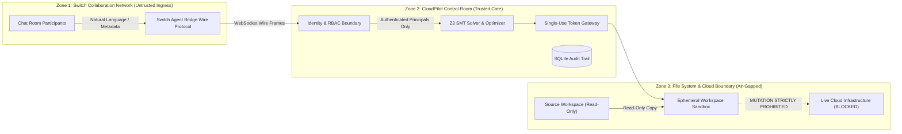

# CloudPilot SwitchOps — Phase 4.2 Security Boundaries & Threat Model
## Adversarial Protections, Identity Boundaries & Air-Gapped Sandboxing

---

## 1. Threat Model & Trust Boundaries

CloudPilot SwitchOps mediates high-stakes cloud engineering operations across three trust zones:

---

## 2. Ingress Identity & RBAC Boundaries

### 2.1 Never Trust Caller Display Names or Client Role Headers
In a shared chat room, participants can change their visible display name (e.g., "Principal Security Architect") or inject JSON metadata fields (`"user_role": "ADMIN"`). CloudPilot SwitchOps enforces:
1. **Server-Side Principal Directory (`SERVER_PRINCIPAL_DIRECTORY`):** Sender handles (`@user:switch`) are mapped directly against an internal, immutable server-side database.
2. **Anti-Escalation Detection:** If incoming metadata attempts to claim a role different from the directory-assigned role, the request is flagged as `ROLE_ESCALATION_REJECTED` and the principal is marked unauthenticated.
3. **Fail-Closed Default:** Unrecognized senders receive role `VIEWER` with `authenticated=False`.

### 2.2 Strict Separation of Duties
- **Discovery & Analysis:** Can be requested by any participant (`VIEWER`, `OPERATOR`, `PLATFORM_LEAD`).
- **Proposal Authorization & Rejection:** Restricted strictly to `PLATFORM_LEAD` or `ADMIN`.
- **Execution:** Automated execution occurs only upon valid authorization binding.

---

## 3. Cryptographic Token Integrity & Secret Redaction

### 3.1 Token Redaction from Chat Rooms
HMAC approval tokens (`v1.tok-...`), Bearer tokens, and cloud credentials must never appear in human collaboration rooms.
- `SwitchMessageMapper.redact_for_switch()` filters all outbound text using regex patterns, replacing tokens with `[REDACTED_APPROVAL_TOKEN]` and `Bearer [REDACTED]`.

### 3.2 Single-Use Cryptographic Invalidation
- Approval tokens are generated with high-entropy nonces and hashed with HMAC-SHA256.
- A token is consumed at the instant of authorization. Replaying the token returns `409 Conflict`.

---

## 4. Air-Gapped Local Sandbox Model

### 4.1 Prohibition of Live Cloud Mutations
Live cloud writes are prohibited by architecture:
- No subprocess execution of `terraform apply`, `terraform destroy`, `pulumi up`, `aws`, or `gcloud`.
- No outbound cloud provider mutation API calls (AWS STS, EC2, IAM, S3).
- Only local declarative configuration files (`.tf`, `.yaml`, `.yml`) are analyzed and mutated.

### 4.2 Workspace Isolation & Pre-Execution Recovery Snapshots
Before any mutation:
1. A temporary workspace directory is allocated: `.cloudpilot/workspaces/exec-<id>`.
2. Target files are copied into the workspace.
3. A pre-execution snapshot is captured: `.cloudpilot/workspaces/exec-<id>/.cloudpilot_snapshot/`.
4. If syntactic validation or SHA-256 post-checks fail, `RecoveryManager` immediately restores the snapshot, transitions the proposal to `RECOVERED`, and emits an incident report to the Switch room.
5. The original repository source files (`samples/`) remain immutable and read-only.
