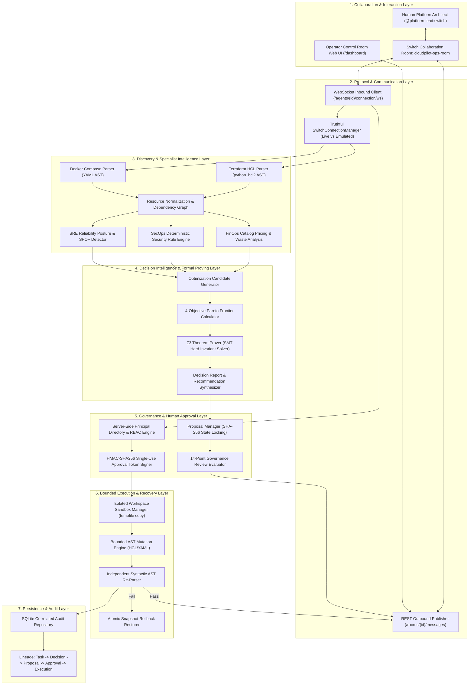
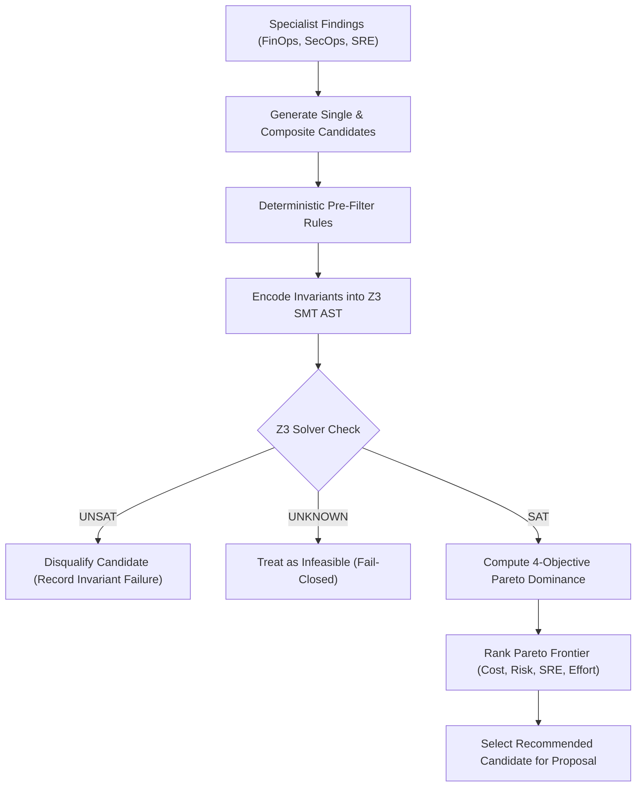
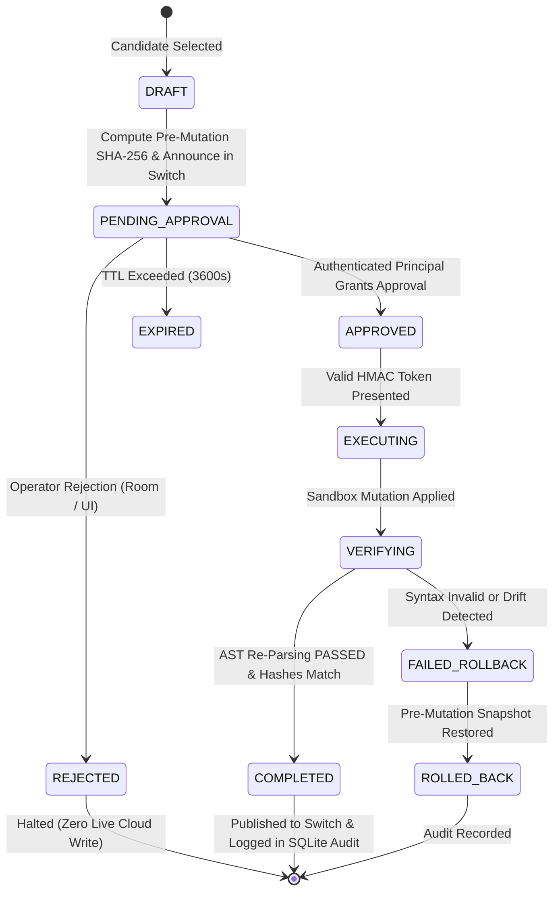

# CloudPilot SwitchOps — Submission Architecture Specification

**Project:** CloudPilot SwitchOps  
**Document:** Complete System Architecture & Formal Models  
**Release Tag:** `v4.3.0-submission-ready`  
**Track:** Flip the Switch — Track 01: Best Business Workflow  

---

## 1. High-Level System Architecture

CloudPilot SwitchOps implements a modular monolith in Python 3.11+ using FastAPI, Pydantic v2, and SQLite. It bridges human operators in Switch collaboration rooms with deterministic cloud intelligence and formal verification engines.



---

## 2. Multi-Objective Optimization & Z3 Solver Formal Model

CloudPilot formulates infrastructure optimization as a constrained multi-objective problem:

$$\max_{\vec{x}} \left( \Delta \text{Cost}(\vec{x}), -\text{Risk}(\vec{x}), \Delta \text{Reliability}(\vec{x}), -\text{Effort}(\vec{x}) \right)$$

Subject to:

1. **Security Invariant 1 (No Public Database Exposure):**
   $$\forall r \in \text{Resources}, \quad \text{IsDatabase}(r) \implies \neg \text{IsPubliclyAccessible}(r)$$
2. **Security Invariant 2 (Persistent Storage Retention):**
   $$\forall v \in \text{Volumes}, \quad \text{IsPersistentData}(v) \implies \neg \text{IsDeleted}(v)$$
3. **Security Invariant 3 (No Root Privilege Escalation):**
   $$\forall c \in \text{Containers}, \quad \text{Privileged}(c) = \text{False}$$
4. **FinOps Invariant 4 (Aggregate Budget Ceiling):**
   $$\sum_{r} \text{Cost}_{\text{after}}(r) \le \text{BudgetCeiling}$$



---

## 3. Cryptographic Human-in-the-Loop State Machine



---

## 4. Bounded Sandbox Execution Boundary

```
+-------------------------------------------------------------------------------+
|                       SOURCE ENVIRONMENT (COMPLETELY READ-ONLY)               |
|                                                                               |
|   d:\CloudPilot AI\samples\staging                                            |
|   ├── main.tf              (SHA-256: 25e4cbf7... LOCKED PRE-MUTATION)         |
|   └── docker-compose.yml   (SHA-256: 8a4b2c1d... LOCKED PRE-MUTATION)         |
+---------------------------------------+---------------------------------------+
                                        |
                           CLONE TO TEMPORARY DIRECTORY
                                        |
                                        v
+---------------------------------------+---------------------------------------+
|                   ISOLATED WORKSPACE SANDBOX (BOUNDED EXECUTION)             |
|                                                                               |
|   C:\Users\...\AppData\Local\Temp\cloudpilot_sandbox_xyz\                     |
|   ├── main.tf              (Target of AST Attribute Mutation)                 |
|   └── docker-compose.yml   (Target of Compose Resource Limits Mutation)       |
|                                                                               |
|   SAFETY CHECKS:                                                              |
|   1. Pre-execution SHA-256 matches locked proposal hash exactly.             |
|   2. Zero network calls or cloud provider SDK writes allowed.                 |
|   3. terraform apply / pulumi up execution strictly prohibited.              |
|   4. AST re-parsed independently to guarantee 100% syntactically valid code.  |
|   5. If parsing fails, atomic snapshot restores original pre-mutation file.   |
+-------------------------------------------------------------------------------+
```

---

## 5. Switch Protocol Wire Contract

- **WebSocket Handshake:** `GET {bridge_ws}/agents/{agent_id}/connection/ws` with `Authorization: Bearer {token}`
- **Heartbeat & Cursor:** Ping-pong heartbeat with monotonic sequence cursor tracking to prevent lost room messages.
- **Outbound Notifications:** Structured JSON payload delivered to `{bridge_url}/rooms/{room_id}/messages`.
- **Truthful Status Reporting:** Reports `EMULATED_MODE` when local daemon is absent; reports `LIVE_CONNECTED` only upon completed bi-directional remote handshake.

